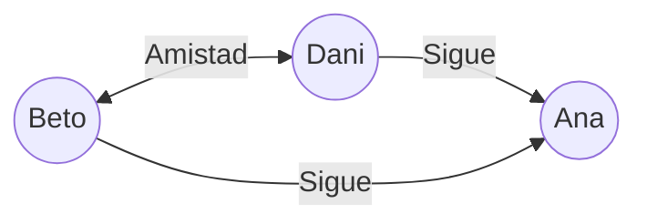

# RED SOCIAL DINÁMICA

## Objetivo
Simular el funcionamiento de un grafo dinámico mediante la creación, modificación y eliminación de usuarios y relaciones.

## Reglas implementadas
* **Sin auto-amistades:** No se permiten amistades de una persona consigo misma.
* **Amistad bidireccional:** Una amistad funciona en ambos sentidos (`A <-> B`).
* **Seguimiento unidireccional:** Un seguimiento funciona en una sola dirección (`A -> B`).
* **Eliminación en cascada:** Al eliminar un usuario, desaparecen automáticamente todas sus conexiones entrantes y salientes.

---

## Evolución de la simulación
1. **Creación de usuarios:** Se agregaron los nodos `Ana`, `Beto`, `Carlos` y `Dani`.
2. **Relaciones iniciales:**
   * Amistades: `Ana <-> Beto`, `Beto <-> Carlos`.
   * Seguimientos: `Ana -> Carlos`, `Carlos -> Dani`, `Dani -> Ana`.
3. **Modificaciones aplicadas:**
   * Se eliminó la amistad `Ana <-> Beto`.
   * Se creó la amistad `Beto <-> Dani`.
   * Se creó el seguimiento `Beto -> Ana`.
4. **Eliminación de usuario:** Se eliminó a `Carlos` junto con sus conexiones (`Beto <-> Carlos`, `Ana -> Carlos`, `Carlos -> Dani`).

---

## Esquema final de la red social (Paso 5)

### Tabla de adyacencia resultante

| Usuario (Vértice) | Amistades (Bidireccional) | Seguimientos salientes (Unidireccional) |
| :--- | :--- | :--- |
| **Ana** | Ninguna | Ninguno |
| **Beto** | Dani | Ana |
| **Dani** | Beto | Ana |
